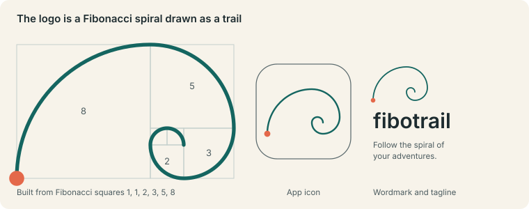
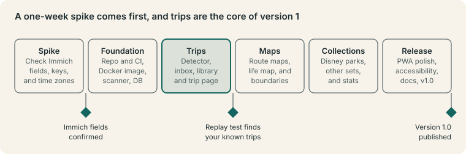

# Fibotrail — Design & Branding Document

Nov 14, 2026 · @Brad Reimer

Fibotrail is a self-hosted web app that turns your Immich photo library into a travel journal: it finds your trips, maps them, and counts them. This document defines the brand, the experience, and the architecture for version 1. The code will live at [github.com/bradreimer/fibotrail](https://github.com/bradreimer/fibotrail).

## Vision

Immich stores your photos well, but it has no idea what a trip is. Fibotrail reads your library, proposes trips for you to confirm, and then lets you browse, map, and measure your vacations. It answers questions such as "How many Disney parks have I visited?" and "Where have I been this year?"

**Product statement:** Fibotrail helps you relive and celebrate every trip you've taken, using the photos you already own.

### How it works, in one line

Immich supplies photos and GPS. Fibotrail adds trips, places, collections, and statistics on top, and never changes your library.

### Goals

- Discover trips automatically and let you accept or ignore each one, much like Home Assistant discovers devices.
- Give every trip a page with a route map, infographics, and a photo timeline.
- Show your whole travel history on a life map, with a world map that fills in as you travel.
- Track custom collections, such as Disney parks, with clear progress (for example, 7 of 12).
- Work well on phone and iPad, and run as a single Docker deployment next to Immich.

### Non-goals for version 1

- Trip planning, itineraries, and bookings.
- Replacing the Immich photo viewer, uploads, or face recognition.
- Multi-user social features and public sharing.
- Native iOS or Android apps (a responsive web app that installs to the home screen is enough).

### How Fibotrail differs from existing tools

| Tool | What it does well | What Fibotrail adds |
| --- | --- | --- |
| [AdventureLog](https://selfhostyourself.com/services/adventurelog) | Self-hosted travel tracker with a world map, trip planner, and dashboard stats | Automatic trip discovery from photos, and photo-first browsing |
| [Dawarich](https://raw.githubusercontent.com/Freika/dawarich/master/README.md) | Location history with trips, stats, and an Immich photo integration | Photos as the primary source, not GPS tracks, and custom collections |
| [Trip Tale](https://mwm.ai/apps/triptalemap/6790614459) | Groups photos into trips from GPS and timestamps, with Immich support | A self-hosted service you own, an accept-or-ignore inbox, and collections |
| [Immich Power Tools](https://github.com/varun-raj/immich-power-tools) | Library analytics and bulk organizing for Immich | A vacation focus: trips, places, and celebration rather than housekeeping |

None of these tracks custom collections such as "Disney parks visited," which is the clearest gap Fibotrail fills.

## Brand identity

The brand is a golden spiral that grows with every trip you take. It feels warm and personal, a keepsake rather than a dashboard.

### Name

**Fibotrail** (say "FEE-boh-trail") combines *Fibo*, from the Fibonacci sequence, with *trail*, the path you travel. The Fibonacci spiral is the idea behind the logo: it starts small, and each turn is larger than the last, like a travel history that keeps growing. The name is also a personal nod to FIBS, the family's oldest dog.

### Tagline

**Follow the spiral of your adventures.**

Alternates for different contexts:

- Every trip, one spiral. (about pages and the README)
- Collect your vacations. (collections and badges)

### Logo concept

The logo is a golden-ratio spiral drawn as a single trail, with a pin at the outer end that marks your newest trip. It is built from Fibonacci squares (1, 1, 2, 3, 5, 8), so every curve comes from a real construction. Use it in three forms:

- **App icon:** the spiral in gold and a coral pin on a Deep Ocean rounded square.
- **Wordmark:** the word "fibotrail" in lowercase, set in the display typeface, with the spiral to its left.
- **Favicon and small sizes (below 24 px):** a simplified spiral with one and a half turns and no pin, so it stays readable.

Keep clear space around the logo equal to the width of the smallest square in the construction. Never rotate, recolor outside the palette, or place the spiral on a busy photo without a solid backing.



The drawing shows the shape only. The coral pin sits at the outer end of the trail, and final colors follow the palette below.

### Color palette

The palette comes from three places: sea and sky (teal and ocean), the golden ratio (gold), and warm paper (the background). Contrast ratios were calculated for the pairs shown.

| Role | Name | Hex | Use | Contrast |
| --- | --- | --- | --- | --- |
| Background | Paper | `#F7F3EA` | Page background in light mode | Ink on Paper 13.2:1 |
| Text | Ink | `#1D2B2F` | Body text and headings | Ink on Mist 11.5:1 |
| Primary | Trail Teal | `#146560` | Buttons, links, route lines | 6.2:1 on Paper; white on Teal 6.9:1 |
| Brand dark | Deep Ocean | `#0B3C49` | Headers, app icon, dark map water | Paper on Ocean 10.8:1 |
| Accent | Golden Gold | `#E0A526` | Stamps, achievements, highlights | Gold on Ocean 5.5:1; Ink on Gold 6.7:1 |
| Marker | Sunset Coral | `#E4684A` | Photo pins and "new" badges | Fill only on Paper (3.0:1); 5.4:1 on Night |
| Visited | Meadow | `#7BAE7F` | Visited countries on the world map | Fill only, never text |
| Neutral | Mist | `#DDE6E4` | Borders, dividers, unvisited countries | Fill only |

Dark mode uses **Night** `#0E1A1D` as the background and Paper for text (16.0:1). Links use **Teal Light** `#4FB3AB` (7.1:1) and highlights use Gold (8.1:1).

Color never carries meaning alone. Visited countries also get an outline, and status badges also include an icon and a word.

### Typography

| Use | Typeface | Why |
| --- | --- | --- |
| Display and trip titles | Fraunces (variable, serif) | Warm and personal, like a printed travel book |
| Interface and body | Inter | Clear at small sizes on phone and iPad |
| Numbers and statistics | Inter with tabular figures | Digits line up in stat tiles and charts |

Both typefaces are open source (SIL OFL). Fibotrail serves them from its own container, so no request goes to an external font service.

### Scale and spacing

Sizes and spacing follow Fibonacci numbers, which ties the interface to the logo.

| Token | Value (px) | Use |
| --- | --- | --- |
| Caption | 13 | Metadata, map attributions |
| Body | 16 | Default text |
| Heading 3 | 21 | Card titles |
| Heading 2 | 34 | Section titles |
| Hero | 55 | Big numbers on the life map |
| Spacing steps | 3, 5, 8, 13, 21, 34, 55 | Padding, gaps, and margins |

Card corners use a 13 px radius. Photos keep their original proportions and never get filters.

### Voice and tone

Fibotrail sounds like a friend who loves your trips: warm, specific, and brief. It celebrates milestones without gushing, and it explains problems in plain words.

| Situation | Say | Avoid |
| --- | --- | --- |
| Trip suggestion | "We found a possible trip: Orlando, Mar 15–24. 312 photos." | "Trip candidate detected." |
| Accept and ignore | "Add trip" and "Not a trip" | "Confirm" and "Reject" |
| Milestone | "That's 7 of 12 Disney parks. Five to go." | "Congratulations!!! You're amazing!" |
| Empty state | "No trips yet. Fibotrail is still scanning your library." | "Nothing found." |
| Error | "Can't reach Immich. Check the server address in Settings." | "Error 502." |

Writing rules: use sentence case for headings and buttons, write in the active voice, address the reader as "you," and use numbers instead of adjectives.

### Icons, imagery, and maps

- **Icons:** a 2 px rounded line style, with round caps that echo the trail. Collection badges are circular stamps with a spiral border.
- **Photos:** your own photos are always the hero. Each trip gets a cover photo chosen automatically and changeable by you.
- **Maps:** a quiet, muted base map so that photos and routes stand out. Routes are Trail Teal, the start is a gold dot, and photo pins are coral.

### Motion

Motion tells the story of a journey and stays out of the way. Durations use Fibonacci milliseconds: 144 for hover, 233 for small transitions, 377 for page changes, and 610 for the signature effect, in which the spiral or route line draws itself when a trip opens. Respect the system "reduce motion" setting by showing the final state with no animation.

## Design principles and scenarios

Six principles guide every decision. When two ideas conflict, the one higher on this list wins.

1. **Photos come first.** Your photos are the hero of every screen. Maps and statistics support them, never cover them.
2. **You decide.** Fibotrail suggests trips and places, and nothing is added until you say yes.
3. **Immich stays untouched.** Fibotrail only reads from Immich. It never edits, moves, or deletes your photos.
4. **Celebrate progress.** Show what you've done ("7 of 12 parks") and avoid guilt, streaks, or pressure.
5. **Comfortable on a couch.** Design for phone and iPad first, with large touch targets and one-hand use.
6. **Private by default.** The app runs on your own server and makes no outside calls unless you turn them on.

### Key scenarios

| Scenario | Starting point | What the person sees |
| --- | --- | --- |
| Review a new trip | You return from a vacation and open Fibotrail | A badge on the inbox: "1 possible trip." Tapping it shows dates, a route preview, and a photo strip, with **Add trip** and **Not a trip** |
| Browse memories | You're on the couch with the iPad | A grid of trip cards, each with a cover photo, dates, and place names. Tapping a card opens the trip page |
| Relive a trip | You open a trip | A route map that draws itself, key numbers, and a photo timeline grouped by day |
| Check collections | You wonder how many Disney parks you've visited | A collection page with a progress ring, each park as a stamp, and the trips where you visited |
| See the big picture | You open the life map | A world map that fills in as you travel, plus counts for countries, cities, days away, and distance |
| Fix a mistake | A trip was split in two, or a photo is in the wrong place | You can merge trips, split one by date, change the dates, or reassign a place, and the change sticks across rescans |

### Who it's for

The first user is the owner of the Immich server, who is also the main viewer. A second household member can have a read-only login in a later version.

## Features

Version 1 has seven features. The first five are required for release, and the last two make daily use pleasant.

| # | Feature | What it does | Priority |
| --- | --- | --- | --- |
| 1 | Trip inbox | Suggests detected trips for you to add or ignore | Must |
| 2 | Trip library | Shows trips as cards with a cover photo, dates, and places | Must |
| 3 | Trip page | Shows a route map, infographics, and a photo timeline for one trip | Must |
| 4 | Life map | Shows every place you've been, with a world map that fills in | Must |
| 5 | Collections | Tracks sets of places, such as Disney parks, with progress | Must |
| 6 | Exploration analytics | Shows your travel history in numbers | Should |
| 7 | Settings and rescans | Controls the Immich connection, home location, and detection rules | Should |

### 1. Trip inbox

The inbox works like device discovery in Home Assistant. Fibotrail scans your library, groups photos into possible trips, and lists each one as a suggestion. Each suggestion shows the dates, the main places, the photo count, and a small route preview.

- **Add trip** turns the suggestion into a trip. You can rename it and pick a cover photo.
- **Not a trip** hides it for good. Fibotrail remembers the choice, so rescans don't bring it back.
- **Later** keeps it in the inbox without a reminder.
- A suggestion that gains many new photos after you ignored it does not reappear. You can find ignored items under **Ignored** and restore them.
- You can also create a trip by hand by choosing a date range or an Immich album.

### 2. Trip library

The library is a grid of trip cards. Each card shows a cover photo, the trip name, dates, the main destination, and a collection badge if the trip counts toward one. You can filter by year, country, or collection, and sort by date or size.

### 3. Trip page

Every trip page has the same four parts, from top to bottom:

1. **Header:** cover photo, name, dates, and the number of days.
2. **Route map:** the GPS trace of where you went, with coral pins where you took clusters of photos. Tapping a pin shows those photos.
3. **Infographics:** tiles for days, photos, places, countries, distance, and the farthest point from home.
4. **Photo timeline:** photos grouped by day, each day with a small map. Tapping a photo opens it in a viewer, and a link opens the original in Immich.

### 4. Life map

The life map shows every place you've been on one map. Countries you've visited fill in with Meadow green, and you can zoom in to see regions, cities, and every trip route. The page also shows your first visit to each country and a count of countries visited.

### 5. Collections

A collection is a named set of places, such as "Disney parks." Fibotrail matches your photos to each place by GPS position, and a place counts as visited when enough photos fall inside its boundary. Collections show a progress ring, a stamp for each place, and the trips behind each stamp. See the place catalog section for how collections are defined.

Launch collections:

- Disney parks worldwide
- Countries and regions you've visited
- National parks in Canada and the United States

You can add your own collection by writing a small data file, with no code changes.

### 6. Exploration analytics

This page turns your history into numbers. Every metric is computed from confirmed trips only.

| Metric | Definition |
| --- | --- |
| Countries, regions, cities | Distinct places with at least one confirmed trip |
| Continents | Continents with at least one visited country |
| Days away | Total days across all trips |
| Distance traveled | Sum of the straight-line legs between consecutive photo clusters |
| Farthest from home | Greatest distance from your home location |
| Trips per year | Count of confirmed trips by calendar year |
| Longest trip | Trip with the most days |
| Collection progress | Places visited out of places in each collection |

### 7. Settings and rescans

Settings cover the Immich address and API key, your home location, and the detection rules (minimum days, minimum photos, and minimum distance from home). A rescan runs on a schedule and on demand, and it only processes photos added or changed since the last run.

## Screens and navigation

Fibotrail has four main areas (Trips, Map, Collections, and Stats), plus the inbox and settings. The same structure works on phone and iPad, and only the layout changes.

### Navigation by device

| Device | Width | Navigation | Layout |
| --- | --- | --- | --- |
| Phone | Under 600 px | Bottom tab bar with four tabs; inbox and settings in the top bar | One column; the map opens full screen |
| iPad portrait | 600–1023 px | Left sidebar that collapses to icons | Two columns on the trip page: map and photos |
| iPad landscape and desktop | 1024 px and up | Full left sidebar with labels | Split view: list on the left, detail on the right |

All tap targets are at least 44 × 44 px. The app installs to the home screen as a progressive web app, so it opens full screen with its own icon.

### Screen guide

| Screen | Purpose | Main elements |
| --- | --- | --- |
| Inbox | Review suggested trips | List of suggestion cards, each with a route preview and the buttons **Add trip**, **Not a trip**, and **Later**; a tab for **Ignored** |
| Trips | Browse all trips | Filter bar, then a grid of trip cards (1 column on phone, 2 on iPad portrait, 3 on iPad landscape) |
| Trip page | Relive one trip | Cover header, route map, infographic tiles, day-by-day photo timeline |
| Map | See everywhere you've been | World map with visited countries filled, zoom to regions and cities, a switch to show routes, and a summary strip of counts |
| Collections | See progress toward sets | Cards with a progress ring and the count (for example, 7 of 12) |
| Collection detail | See each place in a set | Grid of stamps (gold when visited, gray when not), with the trips behind each stamp |
| Stats | See your history in numbers | Stat tiles, a trips-per-year chart, and a list of records such as the longest trip |
| Photo viewer | Look at one photo | Full-screen photo, swipe between photos, small map of where it was taken, and an **Open in Immich** link |
| Settings | Configure the app | Immich connection, home location, detection rules, scan schedule, and a rescan button |

### Screen states

Every screen handles four states the same way:

- **Loading:** gray skeleton shapes in the final layout, never a blank page.
- **Scanning:** a slim banner with progress, such as "Scanning your library: 12,400 of 48,000 photos." The app stays usable while it scans.
- **Empty:** a friendly message and one clear next step.
- **Error:** a plain explanation and a button to retry or open Settings.

### Accessibility

- Text and key controls meet WCAG 2.2 AA contrast, using the palette ratios above.
- Every photo has alt text built from its date and place.
- The whole app works with keyboard and screen reader, and honors the system text size and reduce-motion settings.

## UI design system

The design system is a small set of tokens and components, so every screen feels related and new screens are quick to build. Components are flat, with a 1 px Mist border, a 13 px corner radius, and 21 px padding. Shadows appear only on dialogs and menus.

### Design tokens

Tokens live in one CSS file, and dark mode swaps the values.

```css
:root {
  --fibo-paper: #F7F3EA;   --fibo-ink: #1D2B2F;
  --fibo-teal: #146560;    --fibo-ocean: #0B3C49;
  --fibo-gold: #E0A526;    --fibo-coral: #E4684A;
  --fibo-meadow: #7BAE7F;  --fibo-mist: #DDE6E4;
  --fibo-radius: 13px;
  --fibo-space-1: 3px;  --fibo-space-2: 5px;  --fibo-space-3: 8px;
  --fibo-space-4: 13px; --fibo-space-5: 21px; --fibo-space-6: 34px;
  --fibo-dur-fast: 144ms; --fibo-dur-base: 233ms; --fibo-dur-page: 377ms;
}
@media (prefers-color-scheme: dark) {
  :root { --fibo-paper: #0E1A1D; --fibo-ink: #F7F3EA; --fibo-teal: #4FB3AB; }
}
```

### Core components

| Component | Description | Behavior |
| --- | --- | --- |
| Button | Primary is a Teal fill with white text; secondary is a Teal outline | **Add trip** is primary. **Not a trip** is secondary, not red, because ignoring is a normal choice |
| Suggestion card | Route preview, dates, places, photo strip, three actions | Swipe right to add and left to ignore on touch screens, with buttons always visible |
| Trip card | 4:3 cover photo, title in Fraunces 21, dates in Inter 13, optional collection badge | Tap opens the trip page; the cover photo has a bottom gradient so text stays readable |
| Stat tile | Large number in Fraunces (55 px on iPad, 34 px on phone), label in Inter 13, small icon | Numbers use tabular figures and count up once, over 610 ms, when first shown |
| Progress ring | Gold arc on a Mist track with the count in the center, for example "7 / 12" | Fills clockwise over 610 ms; a full ring shows a small spiral flourish |
| Stamp | Circular badge with a spiral border and the place name | Gold and inked when visited; gray outline when not; tap shows the trips behind it |
| Photo grid | Even rows that keep each photo's proportions | Loads thumbnails first and the larger image on tap |
| Banner | Slim bar under the header for scanning and errors | Dismissible, and shows progress while a scan runs |
| Tab bar and sidebar | Four destinations with icon and label | The active item is Teal with a Gold marker |

### Map styling

| Element | Light style | Dark style |
| --- | --- | --- |
| Water and land | Pale Mist water, Paper land, muted labels | Night land, Deep Ocean water |
| Trip route | Trail Teal line, 4 px, with a 2 px Paper outline | Teal Light line, 4 px |
| Route start | Gold dot, 13 px | Gold dot, 13 px |
| Photo pins | Coral circle, 21 px, with a photo count when clustered | Same |
| Visited countries | Meadow fill at 60% opacity with a 1 px Teal outline | Same, on Night |
| Unvisited countries | Mist fill | A slightly lighter Night |

The base map stays quiet so that your routes and photos are the brightest things on screen. Place names use the user's language when available.

### Infographics

Trip pages and the Stats screen use the same few patterns, so every number looks familiar:

- **Stat tiles** for single numbers (days, photos, countries, distance).
- **Bar chart** for trips per year, in Teal, with the current year in Gold. The bars are labeled directly with their values, and the chart has a light Mist grid and a text alternative.
- **Timeline strip** on each trip: one small square per day, shaded by how many photos were taken.
- **Progress rings** for collections.

Use one accent color per chart, label values directly where there is room, and never rely on color alone.

## Architecture

Fibotrail runs as one Docker container next to Immich. It reads photo metadata through Immich's API, keeps trips and places in its own database, and serves the web app. It never writes to Immich.


Your browser talks only to the Fibotrail server. The scanner reads Immich, the trip detector turns photos into trips and places, and the web server fetches thumbnails on demand.

### Technology choices

| Layer | Choice | Why |
| --- | --- | --- |
| Server | TypeScript on Node.js with Fastify | One language for server and UI, with shared types |
| Web UI | React and Vite, installable as a progressive web app | Fast on phone and iPad, and installs to the home screen |
| Maps | MapLibre GL JS with vector tiles | Open source and needs no account |
| Geometry | Turf.js | Distance, clustering, and point-in-polygon in code |
| Database | SQLite (WAL mode) with Drizzle ORM | One file in the data volume, so backup is a file copy |
| Boundaries | Natural Earth countries and regions | Public domain data for the world map |
| Packaging | Multi-architecture image (amd64 and arm64) on GHCR | Runs on a NAS, a mini PC, or a Raspberry Pi |

The server language is the one decision to confirm before coding starts. Python with FastAPI would also work and is listed under open questions.

### Immich integration

Fibotrail talks to Immich with a dedicated API key and asks for read permissions only.

- **Authentication:** Immich [expects the key in the `x-api-key` header](https://skillsmp.com/creators/michaelvessia/nixos-config/modules-programs-agents-shared-skills-immich) and serves its API under `/api`.
- **Permissions:** Immich lets you [limit a key to specific permissions](https://malemburg.github.io/pymmich/api-permissions/). Fibotrail needs `asset.read` (to list photos and read metadata), `asset.view` (for [thumbnails](https://jtenniswood.github.io/espframe/api-key.html)), and `album.read` (to turn an album into a trip).
- **Listing photos:** a paged `POST /api/search/metadata` request with [`withExif` set to true](https://docs.rs/crate/immich-lib/1.2.0/source/src/client.rs) returns each photo's date and GPS position.
- **Thumbnails:** the Fibotrail server fetches `GET /api/assets/{id}/thumbnail` and caches the result, so the browser never sees the Immich key.
- **Place names:** Fibotrail reuses the city, state, and country that Immich already stores for each photo, so no outside geocoding service is needed. A spike in week one confirms the field names.
- **Version changes:** the Immich API changes between releases, and the [reference is generated from an OpenAPI file](https://docs.immich.app/api/). Fibotrail generates its client from that file, pins a tested Immich version range, and runs a contract test against a real Immich in CI.

Fibotrail stores only photo IDs, timestamps, coordinates, and place names. It does not copy original photos.

### Deployment

The example below adds Fibotrail to an existing Immich setup. Adjust the network name to match yours.

```yaml
services:
  fibotrail:
    image: ghcr.io/bradreimer/fibotrail:latest
    container_name: fibotrail
    restart: unless-stopped
    ports:
      - "8080:8080"
    environment:
      IMMICH_URL: http://immich_server:2283
      IMMICH_API_KEY_FILE: /run/secrets/immich_api_key
      TZ: America/Vancouver
    volumes:
      - fibotrail-data:/data
    secrets:
      - immich_api_key
    networks:
      - immich
    healthcheck:
      test: ["CMD", "wget", "-qO-", "http://localhost:8080/healthz"]

networks:
  immich:
    external: true
    name: immich_default

volumes:
  fibotrail-data:

secrets:
  immich_api_key:
    file: ./immich_api_key.txt
```

### Sign-in and access

The first run asks you to set a password for Fibotrail. Sessions use a secure cookie. Run the app behind your existing reverse proxy with HTTPS, and do not expose it to the internet without one.

## Data model and trip detection

Fibotrail separates what it detects from what you decide. Detected data can be rebuilt at any time, while your decisions (accepted, ignored, renamed, merged) are stored separately and always win.

### Data model

| Table | Key fields | Purpose |
| --- | --- | --- |
| `photo` | Immich asset ID, local capture time, latitude, longitude, city, state, country, updated time | A lightweight copy of the metadata Fibotrail needs |
| `trip` | ID, name, start and end date, status (suggested, added, ignored, later), cover photo, fingerprint | One row per detected or hand-made trip |
| `trip_photo` | Trip ID, photo ID, excluded flag | Which photos belong to a trip; you can exclude a photo |
| `place` | ID, name, type (country, region, city, landmark), country code, center point, boundary | Everything that can be "visited" |
| `visit` | Trip ID, place ID, first seen, last seen, photo count | Links trips to places |
| `collection` | ID, slug, name, source file | A named set of places, such as Disney parks |
| `collection_place` | Collection ID, place ID | Which places are in a collection |
| `decision` | Fingerprint, action, note, time | Your choices, kept across rescans |
| `setting` | Key, value | Home location, detection rules, and scan schedule |
| `scan_run` | Start, end, photos seen, status, cursor | History and the resume point for incremental scans |

The `fingerprint` is a stable hash of a trip's start date and main place. It lets a rescan recognize the same trip, so a decision you made once is never asked again.

### Trip detection

Detection is a pipeline of plain rules, so you can predict and tune it. Each step uses a setting listed in the next table.

1. **Collect.** Read new or changed photos through an incremental cursor. Ignore photos with no date and photos whose position is exactly 0, 0.
2. **Find home.** Use the home location from Settings. On first run, suggest the place where you took the most photos on the most days over the past year, and ask you to confirm it.
3. **Mark away photos.** A photo is "away" when it is farther from home than the home radius.
4. **Split into trips.** Sort away photos by time. Start a new trip when a photo appears back inside the home radius, or when no away photo appears for the gap limit.
5. **Filter.** Keep a trip only if it has enough photos and enough days. Day trips are off by default and can be switched on.
6. **Attach photos without GPS.** A photo with no position joins a trip when its time falls inside the trip's dates, which catches camera photos and screenshots.
7. **Find stops.** Group nearby photos into stops using the stop radius. Order the stops by time.
8. **Draw the route.** Connect the stops in order. Immich stores only the places where photos were taken, so the route is a line between stops, not a true GPS track.
9. **Name and score.** Suggest a name such as "Orlando, March 2027" from the most photographed place and month. Label the suggestion High, Medium, or Low confidence from its photo count, days, and distance.
10. **Reconcile.** Match each result to existing trips by fingerprint. New photos extend an added trip when they continue it. Anything else becomes a new suggestion.

### Detection settings

| Setting | Default | Meaning |
| --- | --- | --- |
| Home radius | 50 km | Photos closer than this count as home |
| Gap limit | 72 hours | A pause this long between away photos ends a trip |
| Minimum photos | 20 | Fewer photos than this is not a trip |
| Minimum days | 2 calendar days | Shorter outings are ignored unless day trips are on |
| Stop radius | 1 km | Photos this close together form one stop |
| Include day trips | Off | Allows single-day outings |

Time handling: use the local capture time stored with each photo so that a photo taken at night abroad lands on the right day. Confirm in the week-one spike which time fields Immich returns.

### Quality checks

- Unit tests for each rule, using small synthetic photo sets (a weekend trip, a trip with a gap, a trip with no GPS photos).
- A replay test against your own library: list your known past trips and compare them with the detector's output. The goal is that you accept most High-confidence suggestions without edits.
- A test that a rescan never undoes a decision.

## Place catalog and collections

Collections are what make Fibotrail feel like a stamp book. A collection is a data file that lists places, and Fibotrail matches your photos against those places to decide which ones you've visited. Adding a collection needs no code.

### Launch collection: Disney parks

Disney [operates 12 theme parks across six resort destinations](https://disneyexperiences.com/app/uploads/2024/05/DX-Fact-Sheet_Q3-FY26.pdf), and a [seventh destination in Abu Dhabi is announced but not yet open](https://magicguides.com/disney-parks-around-the-world/). The collection is built from these parks.

| Resort | Location | Parks | Count |
| --- | --- | --- | --- |
| Walt Disney World Resort | Orlando, Florida, USA | Magic Kingdom, EPCOT, Disney's Hollywood Studios, Disney's Animal Kingdom | 4 |
| Disneyland Resort | Anaheim, California, USA | Disneyland Park, Disney California Adventure | 2 |
| Tokyo Disney Resort | Urayasu, Chiba, Japan | Tokyo Disneyland, Tokyo DisneySea | 2 |
| Disneyland Paris | Paris region, France | Disneyland Park, Walt Disney Studios Park | 2 |
| Hong Kong Disneyland Resort | Hong Kong | Hong Kong Disneyland | 1 |
| Shanghai Disney Resort | Shanghai, China | Shanghai Disneyland | 1 |

Parks that are announced but not open appear as a gray "Coming" stamp and do not count toward the total until they open.

### Collection file format

Each collection is one YAML file in the `collections/` folder. The coordinates below are examples only. Final boundaries come from map data.

```yaml
id: disney-parks
name: Disney parks
description: Every Disney theme park in the world
rule:
  min_photos: 3        # photos needed inside a place to count it
  buffer_m: 50         # allowance for GPS error
places:
  - id: magic-kingdom
    name: Magic Kingdom
    group: Walt Disney World Resort
    status: open       # open or planned
    center: [28.4177, -81.5812]
    boundary: boundaries/magic-kingdom.geojson
```

### How matching works

1. Build a spatial index of every place boundary when the app starts.
2. For each photo with a position, find the places whose boundary contains it, allowing the buffer.
3. Count photos per place per trip, and record a `visit` when the count reaches `min_photos`.
4. Update each collection's progress from the visits.

Boundaries are polygons rather than circles, because some places sit side by side. Disneyland Park and Disney California Adventure, for example, are close enough that two circles would overlap.

### Your overrides

- **Mark as visited** adds a stamp for a place you visited without taking photos there.
- **Not a visit** removes a false match, such as a photo taken from a nearby road.

Both are saved as decisions and survive rescans.

### More collections

The first release also includes countries and regions, built from Natural Earth boundaries. Later collections could include national parks in Canada and the United States, provincial parks, and World Heritage sites. Each one is a new data file.

### Data sources and licenses

- Natural Earth boundaries are in the public domain.
- Park boundaries come from OpenStreetMap, which requires attribution. The About screen and README credit OpenStreetMap contributors.

## Privacy, security, and operations

Your photos and travel history are personal, so Fibotrail is built to keep them on your own hardware and to ask for as little access as possible.

### Privacy

- Fibotrail has no telemetry and no accounts with outside services.
- Its only required outside connection is to your Immich server.
- Map tiles are optional to host yourself. A public tile server can see which map areas your browser requests, so the settings offer a self-hosted tile file for people who want no outside requests at all.
- Fibotrail stores photo IDs, times, coordinates, and place names. It does not store original photos, and the thumbnail cache can be cleared at any time.

### Security controls

| Area | Control |
| --- | --- |
| Immich access | A dedicated key with read-only permissions. The key is read from a Docker secret or file, never logged, and never sent to the browser |
| Sign-in | Password hashed with Argon2id, login rate limiting, and a lockout delay after repeated failures |
| Sessions | HttpOnly, Secure, SameSite cookies, with protection against cross-site request forgery |
| Browser | A strict Content Security Policy and no third-party scripts or fonts |
| Thumbnail proxy | Serves only photos that are in Fibotrail's own database, and only from the configured Immich address, so it can't be used to reach other servers |
| Container | Runs as a non-root user, with a read-only root file system and one writable volume |
| Supply chain | Dependency and image scanning in CI, and pinned base images |

### Backups and upgrades

- **Backup:** everything Fibotrail owns is in the `/data` volume. A built-in command writes a consistent copy of the database, and the whole volume can also be snapshotted.
- **Upgrades:** database migrations run at startup, and Fibotrail saves a backup copy before each migration.
- **Rebuild:** a **Rebuild from Immich** button re-derives all detected data and keeps your decisions, so a damaged database is never a disaster.
- **Removal:** deleting Fibotrail removes nothing from Immich.

### Operating the app

| Topic | Plan |
| --- | --- |
| Scan schedule | Nightly by default, plus a manual **Scan now** button; scans are incremental |
| First scan | Runs in the background in batches while the app stays usable; progress shows in the banner |
| Logs | JSON to standard output, with levels you can set |
| Health | `/healthz` for Docker and monitoring; the same status appears in Settings |
| Monitoring | Optional counters at `/metrics` for people who already run Prometheus |

## Roadmap and repository

Version 1 is built in six phases. A one-week spike comes first, because every later phase depends on what Immich actually returns.



The phases are equal in width and not drawn to scale. Each diamond is a gate: the next phase starts only when its criterion is met.

### After version 1

Ideas for later releases, in rough order of value:

- Import real GPS tracks (for example from Dawarich or GPX files) for exact routes.
- A read-only login for a second household member.
- National parks and World Heritage collections.
- A yearly recap page, such as "Your year in trips."
- Home Assistant sensors that expose counts, such as Disney parks visited.

### Definition of done for version 1

- [ ] A fresh install connects to Immich, scans, and shows trip suggestions without manual setup beyond the API key.
- [ ] Adding or ignoring a suggestion works on phone and iPad, and the choice survives a rescan.
- [ ] The trip page, life map, Disney collection, and Stats screen all work with real data.
- [ ] The app passes the accessibility checks in this document.
- [ ] The README explains installation, API key permissions, and backup in under five minutes of reading.

### Repository layout

The code lives at [github.com/bradreimer/fibotrail](https://github.com/bradreimer/fibotrail) as one repository with a small number of packages.

```text
fibotrail/
  apps/
    server/          Fastify API, scanner, trip detector
    web/             React progressive web app
  packages/
    core/            shared types and the pure trip-detection rules
    immich-client/   client generated from Immich's OpenAPI file
  collections/       YAML files and GeoJSON boundaries (disney-parks.yaml)
  docker/            Dockerfile and example compose files
  docs/              this document and decision records
  .github/workflows/ build, test, scan, and publish the image
```

Keeping the detection rules as pure functions in `core` means they can be tested with plain data and no running Immich.

## Risks, open questions, and next steps

The biggest risk is the data: how complete and accurate the GPS and dates in your library are. The week-one spike exists to find out early.

### Risks

| Risk | Effect | Mitigation |
| --- | --- | --- |
| Immich API changes between releases | Scans break after an upgrade | Pin a tested version range, generate the client from the OpenAPI file, and run a contract test in CI |
| Photos without GPS | Missed places and trips | Attach by date to trips, allow trips from a date range or album, and show a count of photos with no location |
| Noisy or wrong GPS | False places and stops | Ignore 0, 0 positions, use a small buffer, and let you override a place |
| Routes are lines between stops | Maps look less exact than a true GPS track | Label them as photo routes, and add GPS track import later |
| Slow first scan on a large library | Poor first impression | Scan in background batches, show progress, and resume from a cursor |
| Places that sit side by side | Photos matched to the wrong park | Use polygon boundaries instead of circles |
| Wrong home location | Too many or too few trips | Ask you to confirm it on first run and make it editable |
| Public map tiles | The tile provider sees which areas you view | Offer a self-hosted tile file |
| Name collisions | Confusion with other projects | Check GitHub, Docker Hub, GHCR, and the App Store before the first release |

### Open questions

1. **Server language:** TypeScript is the recommendation here. Would you rather use Python with FastAPI?
2. **License:** MIT, Apache-2.0, or AGPL-3.0 for the repository?
3. **Second login:** should a household member get their own read-only login in version 1, or later?
4. **Day trips:** should day trips stay off by default, given that nearby outings are common?
5. **Hosting:** where does your Immich server run (for example, Unraid, TrueNAS, Proxmox, or plain Docker)? This affects the compose examples.
6. **First collections:** besides Disney parks and countries, which collection do you want next?
7. **Logo:** do you want me to produce the SVG logo files from the construction described in the brand section?

### Next steps

- [ ] Answer the open questions above.
- [ ] Create a read-only Immich API key with `asset.read`, `asset.view`, and `album.read`.
- [ ] Run the week-one spike: export sample metadata and confirm the date, GPS, and place fields.
- [ ] Produce the logo and icon files in SVG and PNG.
- [ ] Check that the name is free on GHCR, Docker Hub, and the App Store.
- [ ] Create the repository structure, CI, and the first Docker image.

### Sources

Researched on 2026-11-14.

- [AdventureLog](https://selfhostyourself.com/services/adventurelog): self-hosted travel tracker with a world map and trip planning.
- [Dawarich README](https://raw.githubusercontent.com/Freika/dawarich/master/README.md): location history tracker with trips, stats, and Immich integration.
- [Trip Tale](https://mwm.ai/apps/triptalemap/6790614459): photo-based trip detection with Immich support.
- [Immich Power Tools](https://github.com/varun-raj/immich-power-tools): library analytics and organizing tools for Immich.
- [Immich API documentation](https://docs.immich.app/api/): the API is described by an OpenAPI file.
- [pymmich API permissions](https://malemburg.github.io/pymmich/api-permissions/): which Immich permissions cover listing, search, and downloads.
- [Espframe API key guide](https://jtenniswood.github.io/espframe/api-key.html): read-only key permissions for thumbnails and metadata.
- [immich-lib client source](https://docs.rs/crate/immich-lib/1.2.0/source/src/client.rs): an example of the paged metadata search request.
- [Disney Experiences fact sheet](https://disneyexperiences.com/app/uploads/2024/05/DX-Fact-Sheet_Q3-FY26.pdf): 12 theme parks across six resort destinations.
- [Magic Guides: Disney parks around the world](https://magicguides.com/disney-parks-around-the-world/): resort list and the announced Abu Dhabi destination.
